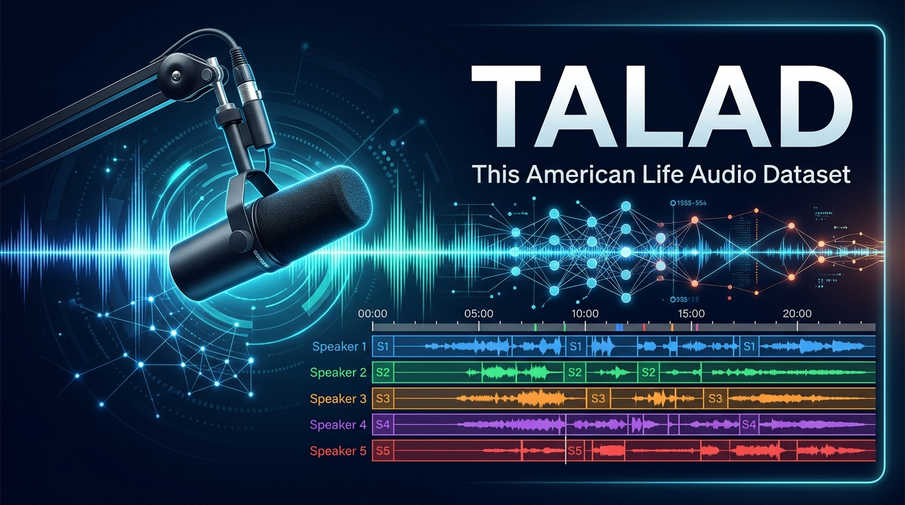

<div align="center">



# TALAD: This American Life Audio Dataset Toolkit

**A modular, high-performance Python toolkit for downloading, transcoding, verifying, and exporting the *This American Life* multi-speaker conversational audio dataset.**

[](https://www.python.org/)
[](https://arxiv.org/pdf/2005.08072.pdf)
[](#audio-transcoding)
[](https://opensource.org/licenses/MIT)

[Overview](#overview) •
[Key Features](#key-features) •
[Dataset Statistics](#dataset-statistics) •
[Installation](#installation) •
[Quick Start (CLI)](#quick-start-cli) •
[Python API](#python-api) •
[Citation](#citation)

</div>

---

## Overview

**TALAD** prepares the audio corpus introduced in **"Speech Recognition and Multi-Speaker Diarization of Long Conversations"** ([Mao et al., INTERSPEECH 2020](https://arxiv.org/pdf/2005.08072.pdf)). The dataset spans **663 episodes** of the *This American Life* radio program (1995–2020), totaling **~637 hours** of richly varied, multi-speaker long-form conversations with an average of **18 unique speakers per episode**.

Because original static server URLs frequently expire or move across CDNs, **TALAD v2.0** implements a resilient **3-tier URL resolution engine**:

1. **Tier 1 — Maintained Archive Catalog (`source/transformed.csv`):** Fast, direct CDN links synchronized with the community-maintained *This American Life* archive.
2. **Tier 2 — Live Official Web Scraper:** Dynamic canonical redirect resolution against `thisamericanlife.org/episode/<id>` that extracts live audio URLs directly from embedded `<script id="playlist-data">` JSON metadata.
3. **Tier 3 — Legacy Archive Fallback (`source/TALArchive.csv`):** Historical Podtrac/PRX redirect links.

> **Copyright Notice:** Audio episodes are copyrighted by *This American Life* / WBEZ Chicago and cannot be redistributed publicly in bulk. This toolkit fetches audio directly from official public streams for private research, local evaluation, or private workspace storage (e.g., private Kaggle datasets).

---

## Key Features

- **Multi-Threaded Downloads & Conversions:** Configurable worker pools (`-j / --workers`) for concurrent episode fetching and parallel audio transcoding.
- **Resilient Native HTTP Streaming:** Built-in chunked HTTP downloader with automatic exponential backoff retries, HTTP `Range` resume support on interrupted `.part` files, and optional `wget` fallback.
- **3-Tier URL Resolution & Live Catalog Sync:** Automatically falls back across curated catalogs and live web scraping; supports one-command upstream catalog refreshes (`--update-catalog`).
- **Standardized Speech ML Transcoding:** Direct `ffmpeg` (and `pydub` fallback) pipeline converting MP3s to **16 kHz, 16-bit mono WAV** (or FLAC/OGG) out of the box.
- **ML Manifest Generation:** Export ready-to-train **JSONL** (NVIDIA NeMo / SpeechBrain / HuggingFace compatible), **CSV**, or **JSON** manifests enriched with episode titles, air dates, descriptions, file sizes, and probed audio durations.
- **Dataset Inspector & Catalog Search:** Built-in CLI subcommands (`status`, `catalog`, `manifest`, `convert`, `clean`) to audit split completeness, detect corrupted files, and search episodes by keyword.
- **100% Backward Compatible:** Existing scripts calling `TAL_download_audio.py -p ... -d ... -w True` or importing `TALDownAudio` continue to work without modification.

---

## Dataset Statistics

| Split | Episodes | Approx. Audio Hours | Partitioning Support | Target Directory |
| :--- | :---: | :---: | :--- | :--- |
| **`train`** | 593 | ~570 hrs | `train`, `train_part_1` .. `train_part_4` | `<download_path>/train/` |
| **`valid`** | 34 | ~32.5 hrs | `valid` | `<download_path>/valid/` |
| **`test`** | 36 | ~34.5 hrs | `test` | `<download_path>/test/` |
| **Total (`all`)** | **663** | **~637 hrs** | `all` | `<download_path>/{train,valid,test}/` |

---

## Architecture & Project Structure

```text
TALAD/
├── assets/
│   └── cover.jpg                  # Repository cover banner
├── source/
│   ├── transformed.csv            # Primary maintained episode catalog & CDN URLs
│   ├── TALArchive.csv             # Fallback archive metadata catalog
│   └── links.txt                  # Legacy reference links
├── train_test_valid_split/
│   ├── train.txt                  # 593 training episode IDs
│   ├── valid.txt                  # 34 validation episode IDs
│   └── test.txt                   # 36 evaluation episode IDs
├── talad/                         # Core modular Python package
│   ├── __init__.py                # Public package exports
│   ├── __main__.py                # `python3 -m talad` entrypoint
│   ├── cli.py                     # Modern subcommand & legacy CLI parser
│   ├── config.py                  # Validated dataclasses (AudioConfig, DownloadConfig, etc.)
│   ├── catalog.py                 # CatalogManager & 3-tier URL resolution
│   ├── downloader.py              # Multi-threaded EpisodeDownloader & TALDatasetDownloader
│   ├── converter.py               # FFmpeg / Pydub parallel audio transcoder
│   └── manifest.py                # DatasetInspector & ManifestExporter (JSONL/CSV/JSON)
├── TAL_download_audio.py          # Backward-compatible CLI & API entrypoint
├── pyproject.toml                 # Modern Python packaging & `talad` console script
└── requirements.txt               # Runtime Python dependencies
```

---

## Installation

### 1. System Prerequisites

Install `ffmpeg` (required for MP3-to-WAV/FLAC conversion and duration probing):

```bash
# Ubuntu / Debian
sudo apt-get update && sudo apt-get install -y ffmpeg wget

# macOS (Homebrew)
brew install ffmpeg wget
```

### 2. Python Package Installation

```bash
git clone https://github.com/jovistos/TALAD.git
cd TALAD

# Install dependencies and register the `talad` CLI command
pip install -e .
```

*(Alternatively, install only dependencies via `pip install -r requirements.txt` and invoke `python3 TAL_download_audio.py` directly.)*

---

## Quick Start (CLI)

TALAD provides both a rich subcommand interface (`talad <command>` or `python3 TAL_download_audio.py <command>`) and full support for the original flag syntax.

### 1. Download Dataset Splits

```bash
# Download the test split as MP3 using 8 parallel workers
python3 TAL_download_audio.py download -p ./data -d test --workers 8

# Download test, valid, and train sets, convert to 16kHz mono WAV, and export a JSONL manifest
python3 TAL_download_audio.py download \
    -p ./data \
    -d test valid train \
    --wav \
    --workers 8 \
    --export-manifest ./data/manifest.jsonl

# Download only the 1st quarter of the training set (ideal for storage-constrained environments like Kaggle)
python3 TAL_download_audio.py download -p ./data -d train_part_1 --wav

# Download specific episodes by number (e.g. Episodes 186, 513, 704)
python3 TAL_download_audio.py download -p ./data --episodes 186 513 704 --wav

# Dry-run mode: verify and display resolved URLs without downloading audio
python3 TAL_download_audio.py download -p ./data -d test --dry-run
```

### 2. Legacy CLI Syntax (Backward Compatible)

```bash
# Original CLI invocation works identically
python3 TAL_download_audio.py -p /path/to/download_dir -d test
python3 TAL_download_audio.py -p /path/to/download_dir -d test valid train -w True
python3 TAL_download_audio.py -p /path/to/download_dir -d train_part_1 -w True -ar 16000 -ac 1 -ab 16
```

### 3. Inspect Dataset Status & Missing Episodes

```bash
# View completion table, disk usage, and missing episode IDs across splits
python3 TAL_download_audio.py status -p ./data --show-missing
```

### 4. Search & Manage the Episode Catalog

```bash
# Search episodes by keyword in title or description
python3 TAL_download_audio.py catalog --query "Pulitzer"

# Inspect full metadata and resolved CDN URLs for a single episode
python3 TAL_download_audio.py catalog --episode 704

# Refresh local source/transformed.csv from upstream GitHub
python3 TAL_download_audio.py catalog --update
```

### 5. Export ML Manifests (JSONL / CSV / JSON)

```bash
# Generate a JSONL manifest with exact audio durations for NeMo / HuggingFace / SpeechBrain
python3 TAL_download_audio.py manifest \
    -p ./data \
    -o ./data/talad_manifest.jsonl \
    --format jsonl \
    --probe-duration
```

Each line in the exported `.jsonl` manifest follows a clean schema:

```json
{
  "audio_filepath": "/abs/path/to/data/test/683.wav",
  "episode_id": "683",
  "split": "test",
  "format": "wav",
  "size_bytes": 115343360,
  "duration": 3604.48,
  "title": "Beer Summit",
  "pubdate": "Sun, 15 Sep 2019 18:00:00 -0400",
  "episode_url": "https://www.thisamericanlife.org/683/beer-summit",
  "description": "Ten years ago this summer, Henry Louis Gates, Jr. was arrested..."
}
```

---

## Python API

You can integrate `talad` directly into your Python data pipelines:

```python
from pathlib import Path
from talad import (
    AudioConfig,
    CatalogManager,
    DatasetInspector,
    DownloadConfig,
    ManifestExporter,
    TALDatasetDownloader,
)

# 1. Configure multi-threaded download & 16kHz mono WAV conversion
dl_config = DownloadConfig(
    download_dir=Path("./data"),
    data_parts=["test", "valid"],
    max_workers=8,
    retries=3,
)
audio_config = AudioConfig(
    convert_to_wav=True,
    sample_rate=16000,
    channels=1,
    bit_depth=16,
    keep_mp3=False,
)

downloader = TALDatasetDownloader(
    download_config=dl_config,
    audio_config=audio_config,
)
reports = downloader.download()

# 2. Query episode metadata programmatically
catalog = CatalogManager()
ep = catalog.get_metadata("704")
print(f"Episode {ep.episode_id}: {ep.title} ({ep.pubdate})")

# 3. Export a CSV manifest for downstream training
exporter = ManifestExporter(Path("./data"), catalog=catalog)
exporter.export(Path("./data/dataset.csv"), fmt="csv", include_duration=True)
```

---

## Citation

If you use this dataset or toolkit in your research, please cite the original INTERSPEECH 2020 paper:

```bibtex
@inproceedings{mao2020speech,
  title     = {Speech Recognition and Multi-Speaker Diarization of Long Conversations},
  author    = {Mao, Huanru Henry and Li, Shuyang and McAuley, Julian and Cottrell, Garrison},
  booktitle = {Proc. Interspeech 2020},
  pages     = {691--695},
  year      = {2020},
  url       = {https://arxiv.org/pdf/2005.08072.pdf}
}
```
